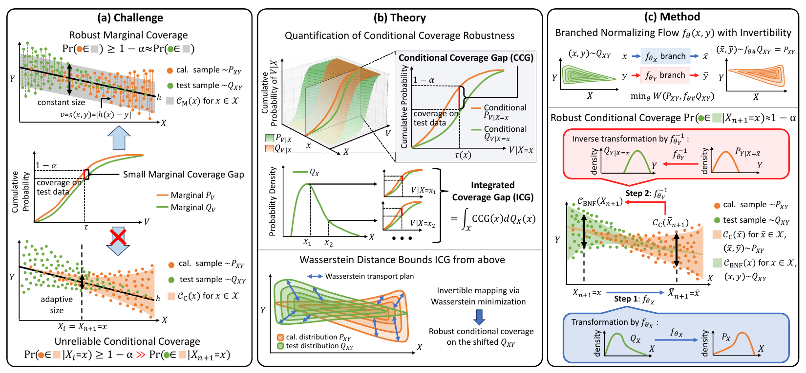

# Robust Conditional Conformal Prediction via Branched Normalizing Flow



**Figure 1.** Marginal score alignment can leave conditional coverage unreliable under distribution shift. The paper relates conditional coverage gaps to Wasserstein distance and introduces **Branched Normalizing Flow (BNF)** to transport prediction sets between distributions.

BNF transforms test features toward the calibration distribution, constructs a conformal prediction set for the transformed input, and maps that set back through the inverse label transformation. Its separate feature and label branches allow the input transformation to be evaluated without the unknown test label. Under exact population transport, this construction preserves an oracle conditional coverage guarantee; the experiments evaluate its finite-sample performance.

This repository contains **Augmented BNF**, **Augment-Conditioned BNF**, five conformal prediction baselines, and experiments for multi-source domain generalization (MSDG) and multiplicative label perturbations. It also includes a CQR reference evaluated on prepared i.i.d. test sets.

## Environment

Download the packaged Linux environment, `nfcp-linux.tar.gz`, from our [Hugging Face bucket](https://huggingface.co/buckets/rxu0112/Branched-normalizing-flow), or use the [Hugging Face CLI](https://huggingface.co/docs/huggingface_hub/guides/buckets#download-a-single-file-with-the-cli):

```bash
python -m pip install --upgrade huggingface_hub
hf buckets cp hf://buckets/rxu0112/Branched-normalizing-flow/nfcp-linux.tar.gz ./nfcp-linux.tar.gz
```

Use a compatible Linux system with an NVIDIA GPU and driver. Extract the archive into a new, permanent directory and initialize the environment with [conda-pack's installation procedure](https://conda.github.io/conda-pack/#commandline-usage):

```bash
mkdir -p "$HOME/envs/nfcp"
tar -xzf nfcp-linux.tar.gz -C "$HOME/envs/nfcp"
source "$HOME/envs/nfcp/bin/activate"
conda-unpack
```

For later sessions, activate it with `source "$HOME/envs/nfcp/bin/activate"`. Run `conda-unpack` only during installation, and keep the installed environment at the same path. Before running experiments, check that PyTorch can access the GPU:

```bash
python -c "import torch; print(torch.cuda.is_available())"
```

The check should print `True`.

## Repository structure

```text
.
├── assets/                  # Figure 1 used in this README
├── main/                    # BNF models and shared utilities
│   └── module.py            # Coverage metrics and supporting functions
├── baselines/               # SCP, CQR, IW-CP, WC-CP, and WR-CP
├── data/                    # Prepared training, calibration, and test splits
├── result/                  # Saved experiment records
├── evaluation/
│   ├── msdg/                # MSDG comparisons and ablations
│   └── perturbed/           # Label-perturbation comparisons
└── figure/                  # Generated PDF figures
```

## Data

The training scripts select the following four public settings by default:

| Dataset identifier | Dataset or setting |
| --- | --- |
| `bike` | Bike Rental |
| `bio` | Physicochemical Properties of Protein Tertiary Structure (PTS) |
| `traffic` | Traffic (Seattle-Loop, PEMSD4, and PEMSD8) |
| `states` | U.S. Influenza-like Illness (ILI) |

The Fair Med setting (`hospital`) includes data from a collaborating hospital that cannot be released, so it is excluded from the public training defaults. Plotting scripts retain this comparison and read its saved result files; they do not require the raw hospital data.

Each dataset has ten prepared trials, named `v1` through `v10`. The expected filenames for one trial are:

```text
data/<dataset>/
├── msdg/
│   ├── train_v1             # Pickled list of source training sets
│   ├── cal_uni_v1.npy       # Calibration set
│   └── test_v1              # Pickled list of mixture test sets
├── iid/
│   ├── train_v1             # Pickled list of three source training sets
│   ├── cal_uni_v1.npy       # Calibration set
│   └── test_v1              # Pickled list of 100 test sets
└── perturbed/
    ├── train_v1.npy         # Unperturbed training set
    ├── cal_v1.npy           # Unperturbed calibration set
    └── test_v1.npy          # Base test set for label perturbations
```

The MSDG and IID `train_v1` and `test_v1` files store multiple training and test sets, respectively, as pickled lists. We use extensionless filenames for these collections. Prepared records use `images` for features and `labels` for regression targets. The `bio_ablation_sample_*` and `bio_ablation_env_*` folders provide PTS splits for varying training sample size and source count, respectively.

## Running experiments

Run all commands **from the repository root**. Use `python -m` as shown below so imports such as `from main.module import ...` resolve correctly.

By default, each training command runs all four public settings and all ten trials. Select a smaller run by changing the `--dataset` and `--version` list defaults to, for example, `['bike']` and `['v1']`. See [Argument conventions](#argument-conventions) before customizing a run.

BNF scripts and `CQR_iid` accept `--device`, which defaults to `cuda:0`. The other baseline scripts use the default CUDA device and do not expose this argument. Training writes to fixed filenames under `result/`; rerunning a configuration replaces its existing result files. Preserve any results you want to compare before rerunning, and ensure the corresponding output directories exist.

### Multi-source domain generalization

Augmented BNF + CQR:

```bash
python -m main.BNF_affine_aug_msdg --conditioned 0 --device cuda:0
```

Augment-Conditioned BNF + CQR:

```bash
python -m main.BNF_affine_aug_msdg --conditioned 1 --device cuda:0
```

The five baselines:

```bash
python -m baselines.SCP_msdg
python -m baselines.CQR_msdg
python -m baselines.IWCP_msdg
python -m baselines.WCCP_msdg
python -m baselines.WRCP_msdg
```

### CQR i.i.d. reference

Evaluate CQR on the prepared splits under `data/<dataset>/iid/`:

```bash
python -m baselines.CQR_iid
```

### Multiplicative label perturbations

These experiments keep features unchanged and scale labels by a factor in `[1, 1.5]`. Augmented BNF uses the unperturbed training set as its alignment reference and a separate calibration set for conformal calibration.

```bash
python -m main.BNF_affine_aug_perturbed --device cuda:0
python -m baselines.SCP_perturbed
python -m baselines.CQR_perturbed
python -m baselines.IWCP_perturbed
python -m baselines.WCCP_perturbed
python -m baselines.WRCP_perturbed
```

The BNF script constructs five perturbed training sets for PTS and ten for the other public datasets, with equally spaced label scales in `[1, 1.5]`. Its 100 test sets use six fixed scales (`1.0, 1.1, ..., 1.5`) followed by 94 uniformly sampled scales; the baseline scripts use 100 uniformly sampled scales.

### Additional BNF variants

Run the following modules with `python -m <module>`. Their default datasets and trials follow the same conventions as the main experiments.

| Experiment | Module |
| --- | --- |
| Augmented BNF + SCP | `main.BNF_affine_no_quantile_msdg` |
| Feature-conditioned BNF | `main.BNF_affine_fea_msdg` |
| PCA-conditioned BNF | `main.BNF_affine_pca_msdg` |
| t-SNE-conditioned BNF | `main.BNF_affine_tsne_msdg` |
| UMAP-conditioned BNF | `main.BNF_affine_umap_msdg` |
| Planar BNF | `main.BNF_planar` |
| Residual BNF | `main.BNF_residual` |

For example, the SCP ablation uses:

```bash
python -m main.BNF_affine_no_quantile_msdg --conditioned 0 --device cuda:0
```

To train the sample-size or source-count ablations, select the corresponding `bio_ablation_sample_*` or `bio_ablation_env_*` folder in the dataset list of `main/BNF_affine_aug_msdg.py` and use `--conditioned 0`.

## Argument conventions

**Configure list arguments in the source.** To select datasets, trials, or WR-CP penalties, edit the corresponding `default=[...]` for `--dataset`, `--version`, or `--w_regularization`. The parsers use list defaults but do not support command-line list overrides.

**Two arguments are assigned automatically during execution:**

| Script | Argument | Effective setting |
| --- | --- | --- |
| `main/BNF_affine_aug_msdg.py` | `--nf_steps` | With `--conditioned 0`: 2,000 steps. With `--conditioned 1`: 2,000 for `bike`/`bio`, 300 for `traffic`, and 100 for `states`. |
| `main/BNF_affine_aug_perturbed.py` | `--num_synthetic_envs` | Five perturbed training sets for `bio`; ten for `bike`, `traffic`, and `states`. |

Command-line values for these two arguments do not override the assignments in the named scripts. Edit those assignments to change the schedules. Other scripts can expose similarly named arguments without this restriction.

Common scalar options for the main affine BNF scripts are:

| Argument | Default | Meaning |
| --- | --- | --- |
| `--device` | `cuda:0` | Device used by the BNF script. |
| `--mlp_steps` | `3000` | Predictor training steps. |
| `--nf_num_layer` | `48` | Flow layer count. |
| `--nf_lr` | `5e-4` | Flow learning rate. |
| `--blur` | `1e-3` | GeomLoss Sinkhorn blur parameter. |
| `--num_samples` | `100` | Candidate-label grid resolution for numerical prediction-set reconstruction. |
| `--num_size_eval_env` | `10` | Number of test sets on which prediction set size is explicitly evaluated. |

Use `python -m main.BNF_affine_aug_msdg --help` to inspect the full parser. The automatic assignments above still apply even when an option appears in the help output.

## Evaluation and saved results

The MSDG and perturbation scripts evaluate `alpha = 0.1, 0.2, ..., 0.9`; the CQR IID script evaluates only `alpha = 0.1`. The corresponding confidence level is `1 - alpha`. Main comparison figures, including the IID comparison, use `alpha = 0.1`, or 90% confidence. Reported metrics include marginal coverage, worst-slice coverage (WSC), worst-slice coverage gap (WSCG), and prediction set size.

With the current affine BNF defaults, coverage metrics use all 100 test sets per trial, while prediction set size is evaluated on the first ten. Across ten trials, this gives 100 explicit size evaluations per dataset and configuration. The remaining test records store the mean of the evaluated sizes; these repeated values are not additional size evaluations. To evaluate size on all 100 test sets in a new run, pass `--num_size_eval_env 100`. Planar/residual BNF and the baseline scripts do not use this ten-test-set restriction.

BNF alignment uses GeomLoss's debiased Sinkhorn divergence with `p=2` and quadratic ground cost as a practical training surrogate. The paper's theoretical Wasserstein bounds remain expressed in terms of the order-1 distance.

Results are pickled lists of records, saved without a filename extension. Standard paths include:

| Method | Result path |
| --- | --- |
| Augmented BNF + CQR | `result/<dataset>/msdg/bnfcqr_aug_<version>_msdg` |
| Augment-Conditioned BNF + CQR | `result/<dataset>/msdg/bnfcqr_aug_cond_<version>_msdg` |
| Augmented BNF + SCP | `result/<dataset>/msdg/bnfscp_aug_<version>_msdg` |
| MSDG baseline | `result/<dataset>/msdg/<method>_<version>_msdg` |
| Augmented BNF + CQR under perturbation | `result/<dataset>/perturbed/bnfcqr_aug_<version>_perturbed` |
| Perturbation baseline | `result/<dataset>/perturbed/<method>_<version>_perturbed` |
| CQR i.i.d. reference | `result/<dataset>/iid/cqr_<version>_iid` |

Here, `<version>` is `v1` through `v10`, and baseline `<method>` is `scp`, `cqr`, `iwcp`, `wccp`, or `wrcp`. Test records have `data == 'test'` and metric arrays indexed by their saved `alpha` array. WR-CP records additionally identify the regularization strength with `beta`; the main plotting scripts select `beta = 1`.

## Generating figures from saved results

Plotting reads the files under `result/` and writes PDFs under `figure/msdg/` or `figure/perturbed/`. Models do not need to be retrained to plot an existing result collection. Dataset selections, trial versions, and confidence levels are configured near the top of the plotting scripts.

Main comparisons:

```bash
python -m evaluation.msdg.fig_coverage
python -m evaluation.msdg.fig_coverage_size
python -m evaluation.msdg.fig_coverage_size_over_datasets
python -m evaluation.perturbed.fig_coverage_size
python -m evaluation.perturbed.fig_coverage_size_over_datasets
```

| Plot | Module | PDF filename |
| --- | --- | --- |
| Main coverage comparison | `evaluation.msdg.fig_coverage` | `coverage_alpha_0.1.pdf` |
| Coverage and size by dataset | `evaluation.msdg.fig_coverage_size` | `coverage_size_alpha_0.1.pdf` |
| Coverage and size pooled across datasets | `evaluation.msdg.fig_coverage_size_over_datasets` | `coverage_size_over_datasets_alpha_0.1.pdf` |
| Confidence-level comparison | `evaluation.msdg.fig_alpha_ablation` | `alpha_ablation.pdf` |
| Training sample-size comparison | `evaluation.msdg.fig_sample_ablation` | `sample_ablation.pdf` |
| Source-count comparison | `evaluation.msdg.fig_env_ablation` | `env_ablation.pdf` |
| SCP/CQR comparison | `evaluation.msdg.fig_scp_cqr_ablation_over_datasets` | `scp_ablation_alpha_0.1_over_datasets.pdf` |
| Flow architecture comparison | `evaluation.msdg.fig_flow_ablation` | `flow_ablation_alpha_0.1.pdf` |
| Feature conditioning by dataset | `evaluation.msdg.fig_feature_ablation` | `feature_ablation_alpha_0.1.pdf` |
| Feature conditioning pooled across datasets | `evaluation.msdg.fig_feature_ablation_over_datasets` | `feature_ablation_alpha_0.1_over_datasets.pdf` |
| Marginal coverage lower bound | `evaluation.msdg.fig_marginal_lower_bound` | `marginal_lower_bound.pdf` |
| Shifted and i.i.d. CQR reference comparison | `evaluation.msdg.fig_cond_lower_bound` | `cond_lower_bound.pdf` |
| Perturbation results by dataset | `evaluation.perturbed.fig_coverage_size` | `coverage_size_alpha_0.1.pdf` |
| Perturbation results pooled across datasets | `evaluation.perturbed.fig_coverage_size_over_datasets` | `coverage_size_over_datasets_alpha_0.1.pdf` |

## Citation

```bibtex
@inproceedings{xu2026robust,
  title     = {Robust Conditional Conformal Prediction via Branched Normalizing Flow},
  author    = {Xu, Rui and Chen, Xingyuan and Huang, Wenxing and Huang, Minxuan and Chen, Weiyan and Xie, Sihong and Xiong, Hui},
  booktitle = {Advances in Neural Information Processing Systems},
  year      = {2026}
}
```
